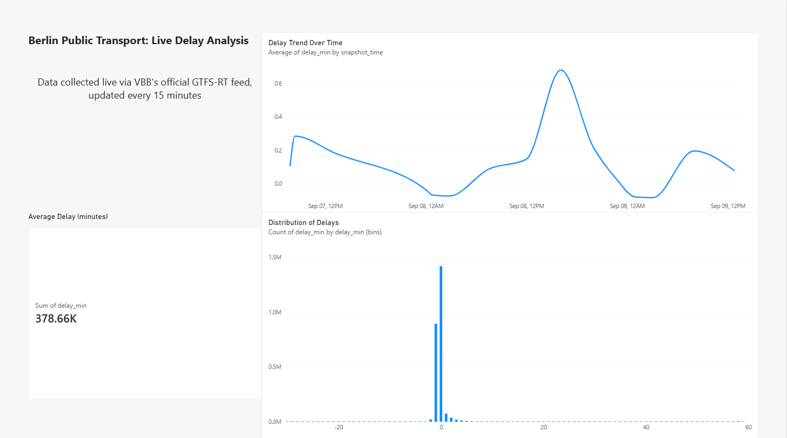

# Berlin Public Transport Delay Analysis

Real-time delay tracking for Berlin's public transit network, built on VBB's official GTFS-RT feed.

## What it does
Fetches live transit data every 15 minutes, compares it against the official schedule, computes real delay in minutes, and logs it automatically via a cloud pipeline — no manual intervention needed.

## Dashboard

## How it works
- **Data sources:** VBB static GTFS schedule + live GTFS-RT protobuf feed
- **Pipeline:** fetch → decode protobuf → match against schedule → compute delay → filter outliers → log with timestamp
- **Automation:** GitHub Actions runs the pipeline every 15 minutes, committing results back to this repo

## Findings so far
- Average delay hovers close to 0 minutes — the network runs close to schedule
- Distribution shows most trips arrive exactly on time, with a secondary cluster ~1 minute early
- [Add your hourly/day-of-week pattern once you have it]

## Challenges solved
- 403 error from official feed → fixed with a proper User-Agent header
- Date-boundary bug (-24hr error) → fixed by deriving date from the realtime timestamp
- Naive row-matching too slow → switched to vectorized pandas merge
- Stale schedule data caused outlier delays → identified, documented, filtered
- Log file exceeded GitHub's 100MB limit → repartitioned to hourly files with trimmed schema

## Limitations
- Early data collection skewed toward weekend/overnight hours; more weekday/rush-hour data being collected
- [Update more soon]
  
## Status
Data collection ran automatically every 15 minutes for about two months, with some gaps from failed runs, and has now been stopped. The repository holds the full dataset as hourly files (`delay_log_YYYY-MM-DD_HH.csv`). The dashboard above is built on the first week of data. The full dataset is too large to load into Power BI in one go, so the next step is to summarise it by hour, weekday and stop, then rebuild the dashboard on those summaries. That will also add a proper weekday-vs-weekend comparison.

## Tech stack
Python, pandas, GitHub Actions, Power BI
